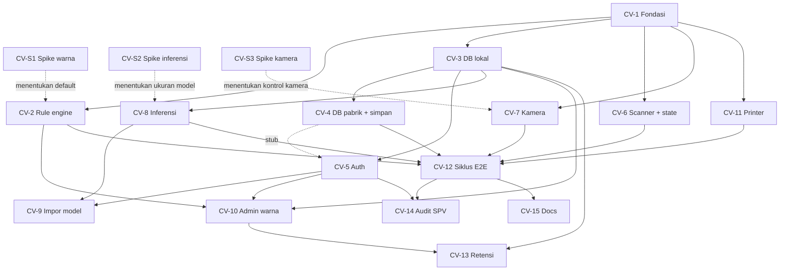

# Ticket Breakdown — Verifikasi Casing (Scan Datapart → Cek Kamera → MATCH / NOT_MATCH)

Sumber: `.claude/casing-verification.prd.md` (intent) dan `.claude/casing-verification.architecture.md` (keputusan).
Repo ini adalah dasar rekonstruksi; kode lama dipakai sebagai referensi gagasan (state machine, import model, pemetaan kolom tabel), bukan disalin.

## Epic summary

Satu station, satu aplikasi lokal di PC edge: operator scan datapart → tekan tombol → kamera mengambil gambar 1 box (6 part, bisa kurang) → model kiri/kanan + pengukuran warna → MATCH/NOT_MATCH → hasil dikirim ke database pabrik → print hanya jika MATCH. FastAPI + web UI kiosk, OpenVINO, PostgreSQL (lokal + pabrik). Target siklus ≤ 10 detik, puncak ±150 box/jam. Kode mudah di-troubleshoot, docstring bahasa Indonesia 1–2 baris per function/parameter.

**Ketergantungan eksternal (di luar tiket, menunggu pemilik produk/engineering):** foto box asli, model YOLO11, format datapart, daftar & toleransi warna, skema tabel pabrik, printer & format print. Tiket di bawah dirancang agar tetap bisa jalan memakai stub/dry-run untuk hal-hal ini.

**Dengan sengaja tidak termasuk:** adapter printer asli, override SPV / alur NOT_MATCH lanjutan, penutup cahaya / pelat referensi, PLC, multi-station.

---

## Tickets

### Kelompok Spike (menjawab risiko sebelum/di samping build)

### CV-S1 — Spike A: Pemisahan warna di cahaya asli
- **Scope / AC:** skrip analisis yang menerima foto box per varian × waktu (pagi/siang/malam), mengukur warna dari mask/ROI dengan ruang warna [YUV/YCrCb, Lab, HSV], dan melaporkan: jarak antar dua varian terdekat vs pergeseran varian yang sama antar waktu, plus rasio per ruang warna. Output: laporan ringkas + rekomendasi ruang warna default dan ambang awal.
- **Per-ticket context:** arsitektur § Spikes (Spike A, aturan keputusan & jalur cadangan), PRD § Hipotesis. Highlight plastik: ukur dengan median / buang piksel terlalu terang.
- **Files (estimasi):** `tools/spikes/color_separation/*`, test kecil untuk fungsi ukur warna · ~300–600 baris.
- **Depends on:** foto dari pemilik produk (eksternal). Tidak bergantung tiket lain.

### CV-S2 — Spike B: Waktu inferensi OpenVINO di i5 gen-13
- **Scope / AC:** skrip benchmark yang memuat model segmentasi (beberapa ukuran) dalam format OpenVINO di PC target, mengukur latensi p50/p95 per frame FHD (termasuk pre/post-process), dan menambah estimasi tulis DB + print simulasi. Output: tabel ukuran model vs latensi + rekomendasi ukuran.
- **Per-ticket context:** arsitektur § Spike B, batas 10 detik siklus.
- **Files:** `tools/spikes/inference_bench/*` · ~200–400 baris.
- **Depends on:** model apa pun berformat OpenVINO (model pra-latih cukup untuk latensi). Independen.

### CV-S3 — Spike E: Kontrol kamera tanpa mini PC bawaan
- **Scope / AC:** skrip yang mencoba mengatur & membaca balik eksposur/gain/white balance lewat UVC dari PC utama; merekam foto permukaan tetap di bingkai pagi/siang/malam untuk menilai kestabilan sebagai acuan koreksi. Output: laporan "bisa/tidak" untuk tiap kontrol.
- **Per-ticket context:** arsitektur § Spike E dan § Missing pieces (cahaya).
- **Files:** `tools/spikes/camera_controls/*` · ~150–300 baris.
- **Depends on:** akses ke kamera asli. Independen.

---

### Kelompok Build

### CV-1 — Fondasi aplikasi (kerangka, log, kode alasan, UI shell)
- **Scope / AC:**
  - Struktur modul per tanggung jawab (kamera, inferensi, aturan box, penyimpanan, printer, auth, UI).
  - Aplikasi FastAPI berjalan lokal di `127.0.0.1`; konfigurasi dari environment; rahasia tidak di repo.
  - Log terstruktur membawa `cycle_id` di setiap baris.
  - Enum **kode alasan** terpusat (mis. campuran kiri/kanan, warna di luar toleransi, keyakinan rendah, tidak ada part, jumlah tidak sesuai, gagal push) + enum state siklus.
  - Shell halaman kiosk (Jinja2 + JS ringan, SSE kosong) dengan tema light/dark lewat CSS variables.
  - Konvensi docstring Indonesia 1–2 baris dan setup test.
- **Per-ticket context:** arsitektur § Recommended approach, § Key decisions (Stack, Other: kode alasan, log, konvensi dokumentasi); PRD § Success Metrics (kemudahan troubleshoot).
- **Files:** `app/main.py`, `app/core/{config,logging,reasons,states}.py`, `app/ui/*`, `tests/` · ~600–1000 baris.
- **Depends on:** none.

### CV-2 — Rule engine box + pengukuran warna (fungsi murni)
- **Scope / AC:**
  - Fungsi murni `(deteksi per part, warna terukur, datapart) → (verdict, kode alasan)` sesuai PRD: campuran kiri/kanan → NOT_MATCH; warna di luar toleransi → NOT_MATCH; ragu / keyakinan di bawah threshold (default 80%) → NOT_MATCH; tidak ada part → NOT_MATCH.
  - Pengukuran warna dari mask dengan ruang warna yang bisa diganti (pluggable), median/buang highlight.
  - Penanganan jumlah part < 6 sebagai aturan yang dikonfigurasi (perilaku final: TBD); default fail-safe.
  - Test tabel-driven (data sintetis) mencakup tiap kode alasan dan batas toleransi.
- **Per-ticket context:** PRD § Hipotesis (aturan keputusan), arsitektur § Recommended approach, § Key decisions (Other), § Open questions (jumlah part).
- **Files:** `app/domain/{box_rules,color}.py`, `tests/domain/*` · ~500–900 baris.
- **Depends on:** CV-1 (kode alasan & konvensi). Default ruang warna diperbarui setelah CV-S1.

### CV-3 — Database lokal: skema, migrasi, repository
- **Scope / AC:**
  - Migrasi SQL berversi untuk: hasil pemeriksaan per box (kolom relasional + JSONB detail per part), varian warna referensi (JSONB), registri model (versi, status aktif, rollback), konfigurasi aplikasi (JSONB, berversi), log audit auth.
  - Repository tipis tanpa ORM berat; validasi JSONB di aplikasi (pydantic) saat menulis.
  - Hanya kolom yang dipakai filter/counter yang berupa kolom biasa.
  - Test terhadap PostgreSQL asli (atau container) untuk migrasi dan repository.
- **Per-ticket context:** arsitektur § Key decisions (Data model, rekomendasi JSONB), § Boundaries (kredensial).
- **Files:** `app/storage/local/*`, `migrations/*`, `tests/storage/*` · ~600–1100 baris.
- **Depends on:** CV-1.

### CV-4 — Adapter database pabrik + simpan atomik (lokal ↔ pabrik)
- **Scope / AC:**
  - Koneksi TLS terverifikasi, akun hak minimal, batas waktu tulis pendek.
  - Pemetaan kolom tabel pabrik sebagai konfigurasi (skema final: TBD), dengan versi dummy untuk test.
  - Urutan simpan: buka transaksi lokal → push pabrik → commit lokal jika sukses, rollback jika gagal. Kegagalan push hanya ditulis ke log dengan `cycle_id` (tidak ke tabel).
  - Test: sukses, gagal push, timeout, dan lokal gagal setelah push sukses (pastikan terlihat di log).
- **Per-ticket context:** arsitektur § Key decisions (Boundaries, Data model), § Open questions (skema pabrik); PRD (gagal push → peringatan, ulang siklus).
- **Files:** `app/storage/factory/*`, `app/services/save_result.py`, `tests/storage/*` · ~500–900 baris.
- **Depends on:** CV-3.

### CV-5 — Auth: login username/password dan RFID, peran, audit
- **Scope / AC:**
  - Operator diautentikasi terhadap tabel operator pabrik; admin boleh via akun pabrik atau akun lokal (salah satu cocok boleh masuk).
  - Akun lokal hanya berperan admin; hash password; batas percobaan gagal; sumber autentikasi dicatat di log audit.
  - Sesi lokal; layar admin butuh peran.
  - Sumber peran untuk akun pabrik: TBD (default operator).
- **Per-ticket context:** arsitektur § Key decisions (Boundaries: Login), PRD § Target User.
- **Files:** `app/auth/*`, `app/ui/login.*`, `tests/auth/*` · ~600–1000 baris.
- **Depends on:** CV-3 (akun lokal & audit); CV-4 (baca tabel operator pabrik, bisa dikerjakan dengan stub lalu disambung).

### CV-6 — Penangkap scanner/RFID + state machine siklus
- **Scope / AC:**
  - Penangkap masukan global di halaman (keyboard-wedge) berbasis kecepatan ketikan, tanpa kolom input; kolom yang sedang fokus didahulukan (login manual).
  - Pembeda RFID vs datapart lewat state (belum login → RFID; sudah login & siklus siap → datapart).
  - Parser datapart lewat antarmuka dengan implementasi stub (format final: TBD).
  - State machine siklus `WAIT_DATAPART → READY → CAPTURING → INFERRING → JUDGED → SAVING → PRINTING → DONE`, transisi tercatat dengan `cycle_id`; tombol capture terkunci sampai datapart valid.
  - Banner "pemindai tidak aktif" saat jendela kehilangan fokus.
  - Uji dengan pemindai USB asli: 0 scan hilang pada rangkaian uji perpindahan fokus.
- **Per-ticket context:** arsitektur § Key decisions (Boundaries: scanner/RFID), § Spike C; PRD § MVP langkah 1.
- **Files:** `app/domain/cycle_state.py`, `app/ui/scan_capture.js`, `app/api/cycle.py`, tests · ~600–1000 baris.
- **Depends on:** CV-1.

### CV-7 — Layanan kamera (capture + preview MJPEG)
- **Scope / AC:**
  - Thread pekerja yang memegang kamera USB FHD; preview MJPEG ke halaman; capture satu frame saat tombol ditekan.
  - Kontrol eksposur/white balance hanya diterapkan jika Spike E membuktikan bisa; selainnya tidak dipaksa.
  - Kamera tidak ada/terputus menghasilkan kesalahan jelas di UI dan log.
  - Gambar disimpan di disk lokal dengan path yang dicatat.
- **Per-ticket context:** arsitektur § Recommended approach (kamera di backend), § Spike E.
- **Files:** `app/services/camera/*`, tests (dengan kamera tiruan) · ~400–700 baris.
- **Depends on:** CV-1. Pengaturan kamera disesuaikan setelah CV-S3.

### CV-8 — Runtime inferensi OpenVINO + registri model
- **Scope / AC:**
  - Muat model segmentasi (kelas kiri/kanan) berformat OpenVINO dari registri; inferensi di thread pekerja; output: kelas, keyakinan, mask per part.
  - Satu model aktif; model sebelumnya tersimpan untuk rollback.
  - Gagal muat model → kesalahan jelas, sistem menolak memulai siklus.
- **Per-ticket context:** arsitektur § Stack (OpenVINO), § Data model (registri model), Spike B.
- **Files:** `app/services/inference/*`, tests (dengan model kecil/tiruan) · ~500–900 baris.
- **Depends on:** CV-1, CV-3. Ukuran model default ditentukan setelah CV-S2.

### CV-9 — Admin: impor model + konversi otomatis ke OpenVINO
- **Scope / AC:**
  - Layar admin untuk mengunggah model (zip / .pt / .onnx / folder OpenVINO), konversi otomatis ke OpenVINO bila perlu, mencatat metadata dan nama kelas, lalu mengaktifkan atau mengembalikan versi.
  - Validasi: kelas harus sesuai (kiri/kanan); kegagalan konversi tampil jelas.
- **Per-ticket context:** arsitektur § Key decisions (Stack: konversi otomatis), § Data model (registri); PRD § Target User (model diatur admin).
- **Files:** `app/admin/models.*`, `app/services/model_import.py`, tests · ~500–900 baris.
- **Depends on:** CV-8, CV-5 (peran admin).

### CV-10 — Admin: varian warna referensi + pengaturan
- **Scope / AC:**
  - Admin menambah/mengubah varian warna (nama, nilai referensi, toleransi) tanpa retrain; pengaturan threshold keyakinan (default 80%), masa simpan gambar (default 3 hari), ruang warna aktif.
  - Perubahan berversi dan tercatat di audit.
- **Per-ticket context:** arsitektur § Data model (varian warna, konfigurasi), PRD (toleransi warna menyusul).
- **Files:** `app/admin/{colors,settings}.*`, tests · ~400–800 baris.
- **Depends on:** CV-3, CV-5, CV-2.

### CV-11 — Printer: antarmuka + simulasi (dry-run) + gerbang print
- **Scope / AC:**
  - Antarmuka `PrintPort` dengan adapter dry-run yang mencatat perintah print; adapter printer asli tidak termasuk (menunggu engineering).
  - Aturan: print hanya dipanggil jika verdict MATCH **dan** rekaman tersimpan; NOT_MATCH atau gagal simpan → tidak pernah memanggil print.
  - Test: tiap jalur keputusan memastikan print dipanggil / tidak dipanggil.
- **Per-ticket context:** PRD § MVP langkah 5–6, arsitektur § Boundaries (PrintPort).
- **Files:** `app/services/printing/*`, tests · ~250–450 baris.
- **Depends on:** CV-1.

### CV-12 — Siklus operator end-to-end (irisan tipis yang membuktikan hipotesis)
- **Scope / AC:**
  - Menyambung CV-2, CV-4, CV-6, CV-7, CV-8, CV-11: scan → tombol aktif → capture → inferensi → rule engine → simpan (lokal + pabrik) → print (dry-run) hanya MATCH → reset.
  - NOT_MATCH: tampil alasan, tidak print, reset siklus. Gagal push: peringatan "push database gagal" dan operator mengulang siklus.
  - UI operator: preview, status siklus (SSE), hasil MATCH/NOT_MATCH jelas, **counter** hasil dari data lokal.
  - Waktu tiap tahap dan total (scan → selesai) dicatat per siklus; uji dengan perangkat tiruan memastikan alur penuh dan semua jalur gagal.
- **Per-ticket context:** PRD § MVP (alur penuh), § Success Metrics (waktu siklus, kelengkapan rekam jejak); arsitektur § Recommended approach.
- **Files:** `app/services/cycle_runner.py`, `app/ui/operator.*`, tests integrasi · ~700–1200 baris.
- **Depends on:** CV-2, CV-4, CV-6, CV-7, CV-8, CV-11.

### CV-13 — Pembersihan gambar otomatis (masa simpan)
- **Scope / AC:**
  - Pekerjaan berkala menghapus file gambar yang melewati masa simpan (default 3 hari, dari pengaturan) dan menandai record "gambar sudah dibersihkan"; record teks tetap.
  - Aman terhadap file hilang dan siklus yang sedang berjalan; hasil pembersihan masuk log.
- **Per-ticket context:** arsitektur § Data model (masa simpan), catatan audit SPV.
- **Files:** `app/workers/retention.py`, tests · ~200–400 baris.
- **Depends on:** CV-3, CV-10.

### CV-14 — Daftar audit SPV + ekspor
- **Scope / AC:**
  - Tampilan/ekspor untuk SPV: semua NOT_MATCH + sampel acak MATCH dalam rentang waktu, menampilkan gambar (jika belum dibersihkan), datapart, hasil model, alasan.
  - Ringkasan metrik pilot: persentase siklus ≤ 10 detik, jumlah per varian warna, jumlah MATCH/NOT_MATCH.
- **Per-ticket context:** PRD § Hipotesis & § Success Metrics, pilot (jumlah box per varian), arsitektur § Data model.
- **Files:** `app/admin/audit.*`, tests · ~400–800 baris.
- **Depends on:** CV-12, CV-5.

### CV-15 — Audit dokumentasi & runbook troubleshoot (Indonesia)
- **Scope / AC:**
  - Pemeriksaan otomatis (lint/test) bahwa setiap function/parameter publik punya docstring Indonesia 1–2 baris.
  - Runbook ringkas: daftar kode alasan & penyebab umum, cara menelusuri satu siklus lewat `cycle_id`, dan langkah saat push gagal / kamera mati / model gagal dimuat.
- **Per-ticket context:** PRD § Success Metrics (kemudahan troubleshoot), arsitektur § Key decisions (Other).
- **Files:** `tools/check_docstrings.py`, `docs/runbook.md`, tests · ~200–400 baris.
- **Depends on:** CV-12 (agar mencakup kode final).

---

## Dependency graph

## Suggested execution order

- **Wave 0 (paralel, tidak ada ketergantungan kode):** CV-S1, CV-S2, CV-S3 (menunggu foto / kamera / PC target) dan **CV-1**.
- **Wave 1 (paralel setelah CV-1 diimplementasikan):** CV-2, CV-3, CV-6, CV-7, CV-11. Modul terpisah, hampir tidak tumpang tindih file.
- **Wave 2 (paralel):** CV-4 dan CV-8 (setelah CV-3); CV-5 (setelah CV-3, memakai stub pabrik dulu).
- **Wave 3 (paralel):** CV-9 (setelah CV-8 & CV-5), CV-10 (setelah CV-2, CV-3, CV-5).
- **Wave 4:** **CV-12** (irisan end-to-end). Ini titik "bisa dipakai untuk pilot dengan printer simulasi".
- **Wave 5 (paralel):** CV-13, CV-14, CV-15.

**Rencana just-in-time:** tiket yang punya ketergantungan direncanakan setelah ketergantungannya *diimplementasikan*. CV-12 khususnya baru direncanakan setelah CV-2, 4, 6, 7, 8, 11 selesai.

**Catatan penting:** Spike A menentukan kelayakan jalur warna. Jika Spike A gagal, jalur cadangan (cahaya terkendali, warna sebagai kelas model, atau mengurangi varian) mengubah CV-2, CV-8, dan CV-10. Sebaiknya hasil CV-S1 dilihat sebelum Wave 3.
